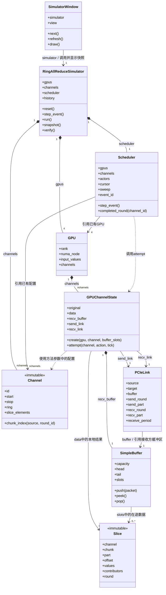

# RingAllReduce：多 Channel / SimpleBuffer 事件模拟器

纯 Python 标准库实现四张逻辑 GPU 的 `A → D → C → B → A` 通信。
默认 **2 个 Channel、每条连接 2 个槽、每个 slice 1 个元素**，GPU D 每 4 个调度 sweep 消费一次。
前 3 个算法步骤归约（ReduceScatter），后 3 个步骤复制完整结果（AllGather）。

这是 CPU 上的教学模型，不调用 CUDA，不访问真实 GPU，也不预测 PCIe 性能。

## 在 VS Code 运行

打开 `D:\RingAllReduce`，按 **Ctrl+Shift+B** 启动图形界面。
已有 `.vscode/tasks.json` 直接调用本机 Python，无需额外依赖；安装 Python Debugger 扩展后也可以 F5 调试。

以下命令在仓库根目录执行

```powershell
& 'C:\Users\xiaoqiandai\AppData\Local\Programs\Python\Python312\python.exe' .\AllReduce\main.py
# 命令行逐事件执行：
& 'C:\Users\xiaoqiandai\AppData\Local\Programs\Python\Python312\python.exe' .\AllReduce\main.py --cli --step
# 使用内置输入，导出完整事件历史：
& 'C:\Users\xiaoqiandai\AppData\Local\Programs\Python\Python312\python.exe' .\AllReduce\main.py --cli --quiet --export traces/channels.json
# 以算法轮次为观察节点，底层仍逐事件运行：
& 'C:\Users\xiaoqiandai\AppData\Local\Programs\Python\Python312\python.exe' .\AllReduce\main.py --cli --rounds
# 测试：
& 'C:\Users\xiaoqiandai\AppData\Local\Programs\Python\Python312\python.exe' -m unittest discover -s AllReduce/tests -t . -v
```

如果 Python 已加入 PATH，可直接使用 `python AllReduce/main.py`。换电脑时需调整 `.vscode/settings.json` 和 `tasks.json` 中的解释器路径。

## 界面怎么看

1. **下一事件**：执行一次发送、接收或等待；不会自动清空 Buffer。
2. **上一事件**：回看不可变的历史快照；不会回滚或再次执行算法。
3. **推进一轮**：快进到所有 Channel 至少完成下一个轮次；不向算法插入屏障。
4. **运行到结束**：完成剩余事件并验证每张卡的最终结果。
5. **图中 Channel**：切换查看不同数据范围。下表同时列出所有 Channel 的链路。
6. **点击链路行**：查看该 Channel / 连接独有的 SimpleBuffer 槽位。
7. **应用并重置**：调整 Channel 数、槽数、slice 长度、慢卡和接收周期后重新运行。

每块的“完成 x/y slice”表示已经包含全部四张卡贡献的小段数量。
绿色表示该 chunk 全部归约完成，蓝色边框表示本事件更新的接收块。
表中轮次 7 表示该发送方或接收方已经完成 6 轮；发送和接收进度可以不同。
表中的状态是该 actor 最近一次尝试结果，不是硬件状态寄存器。

## 类关系图（Mermaid）

下图对应当前 `simulator.py` 与 `gui.py` 中的业务类，仅列出主要字段和方法。
数量表示 `reset()` 完成后的状态；`nchannels` 是配置的通道数。



- `*--`：组合，表示本项目中的创建与归属关系；不表示 Python 的强制销毁规则。
- `-->`：持有对象引用。`..>`：调用或临时使用；没有保存为该对象的字段。
- `Channel` 和 `Slice` 是不可变数据类；图中的类之间没有继承关系。
- 每张 GPU 有 `nchannels` 份独立的 `GPUChannelState`，但所有 GPU 使用同一组 `Channel` 配置。
- 每条有向连接由发送方的 `send_link` 和接收方的 `recv_link` 共同引用；每个 channel 总共 4 条连接、4 个接收 buffer。
- `PCIeLink.source/target` 保存 rank 整数，不直接持有 GPU 对象；GPU 和 Scheduler 均不反向持有模拟器。
- `main.py` 是函数入口，测试文件中的类用于验证，不属于运行时业务对象图。

例如默认环中的 `A → D`，下面三个表达式引用同一份接收缓冲区：

```python
sender = simulator.gpus[0].channels[0]
receiver = simulator.gpus[3].channels[0]
assert sender.send_link is receiver.recv_link
assert sender.send_link.buffer is receiver.recv_buffer
assert receiver.recv_link.buffer is receiver.recv_buffer
```

## 结构与术语

```text
RingAllReduceSimulator
├── gpus[rank] → GPU：输入与 NUMA 标签
│   └── channels[channel_id] → GPUChannelState
│       ├── original：本卡在此 channel 的原始输入（补零后）
│       ├── data[chunk][part]：本卡的中间结果
│       ├── recv_buffer → SimpleBuffer：本卡接收缓冲区
│       │   └── slots、head、tail
│       ├── send_link → PCIeLink：指向下一张卡的接收 buffer
│       └── recv_link → PCIeLink：与上一张卡的 send_link 为同一对象
├── channels → Channel：不可变的数据划分、chunk/slice 大小、环顺序
└── scheduler → Scheduler：公平交错推进各 GPU 的 send / recv
```

GPU 不反向引用模拟器。Scheduler 引用 GPU 和 Channel 配置，调用
`GPUChannelState.attempt()` 执行本地发送或接收；可变数据仅保存在对应 GPU 上。
每条连接由两端共享，`send_link.buffer` 就是下游的 `recv_buffer`，不复制缓冲区。

GUI 调用链：`SimulatorWindow.next()` → `RingAllReduceSimulator.step_event()` →
`Scheduler.step_event()` → `GPUChannelState.attempt()` → `SimpleBuffer.push()/pop()`。
随后模拟器保存快照，GUI 刷新。直接调用 scheduler 不记录 GUI 历史，日常运行应使用模拟器接口。

- **chunk**：算法调度的数据块；每个 Channel 按四卡划分为 4 块。
- **slice**：一个 chunk 中实际传输的小段，带有来源 Rank 集合。
- **slot**：Buffer 中可复用的存储位置；不是一个独立数据块的永久位置。
- **Channel**：软件并发通道，不等于独占的 PCIe lane。

默认输入每卡 32 个元素：C0 处理 `[0,16)`，C1 处理 `[16,32)`。
每 Channel 的 chunk 长度 4，再切成 4 个长度为 1 的 slice。
非整除输入在每 Channel 内补零，最终按该 Channel 的有效长度裁剪并拼接。
空 Channel 不产生数据传输，避免重复处理其他 Channel 的数据。

## SimpleBuffer 和等待

```text
发送：若 tail-head == capacity → WAIT_FULL
      否则先写 slots[tail % capacity]，再推进 tail

接收：若 head == tail → WAIT_EMPTY
      若慢卡尚未到消费时机 → WAIT_DELAY
      否则读取并计算，保存结果后再推进 head
```

发送下一轮某个 slice 时，还必须等上一跳对应 slice 到达，否则出现 `WAIT_DEPENDENCY`。
满 Buffer 不覆盖旧数据，也不推进发送游标；一个槽释放后可以继续发送。
`head`、`tail` 单调增长，只有物理槽位索引对 capacity 取模。

默认示例确实会出现：**SEND → Buffer 满 → WAIT_FULL → RECV 释放 head → SEND 复用槽位**。
把接收周期改为 1 可以去掉人为接收延迟；是否出现其他等待还取决于依赖和槽数。

## 调度与流水化

每个 sweep（界面中称 tick）公平地给每条连接的发送、接收 actor 一次机会，Channel 按环位置交错安排。
`receive_period=4` 表示选定慢卡只在 tick 为 4 的倍数时消费，每次至多一个 slice。
这是为了演示背压的确定性规则，**tick 不代表秒数，周期也不是 GPU 性能参数**。

每条连接维护自己的发送轮次、小段游标和接收游标。
所有发送内容只来自本地已经就绪的 slice；ReduceScatter 恰好加入一次本卡贡献；AllGather 不再加法。
一张卡收到上游小段后就能在满足本地发送顺序时继续转发，无需等待全局所有卡或所有 Channel 完成本轮。
同一 Channel 的发送仍按 chunk/slice 顺序推进，不模拟任意乱序执行。

默认 NUMA 标签为 A/B 在结点 0，C/D 在结点 1，假设所有环边都支持 P2P。
模型不探测真实拓扑，不模拟 PCIe 链路争用或 DMA，也不实现真实内存屏障、LL128、RAS、L3 或设备地址映射。

## Python API

```python
from AllReduce.simulator import RingAllReduceSimulator, demo_inputs

simulator = RingAllReduceSimulator(demo_inputs(), nchannels=2,
                       buffer_slots=2, slice_elements=1,
                       slow_rank=3, receive_period=4)
snapshot = simulator.step_event()
print(snapshot['event'])
simulator.step_round()
results = simulator.run()
assert simulator.verify()
print(results[0])
```

默认最终结果为 `[100,104,108,...,224]`，每张 GPU 一致。
总共 192 次 SEND、96 次 RECV_REDUCE、96 次 RECV_COPY，等待事件另计。
每卡总发送 48 个数值元素；这是两个 Channel 的发送量相加，包含补零时也会计入补零数据。

可以用 `receive_periods={(0,3):7}` 覆盖某个 Channel 上某个接收 Rank 的周期，观察两个 Channel 进度分离。
设置 `simulator.gpus[0].channels[0].send_link.p2p_enabled = False` 会明确报错，不会静默走主机中转。

查看某张卡的 channel 状态：

```python
local = simulator.gpus[3].channels[0]  # GPU D 的 channel 0
print(local.data[1][0])            # chunk 1 的第一个 slice
print(local.recv_buffer.head, local.recv_buffer.tail)
assert simulator.gpus[0].channels[0].send_link is local.recv_link
assert local.recv_link.buffer is local.recv_buffer
print(simulator.scheduler.completed_round(0))
```

本次重构移除了 `Channel.data/original/links`：数据改从 GPU 的本地状态读取；
channel 进度通过 `simulator.scheduler.completed_round(channel_id)` 查询。
GUI、CLI 和 JSON 快照结构保持兼容，`schema_version` 仍为 2。

### 与第一版的 API 差异

- `step()` 现在等价于 `step_event()`；整轮观察请用 `step_round()`。
- 连接位于 `simulator.gpus[rank].channels[channel_id].send_link/recv_link`。
- GUI / JSON 记录每次事件，JSON `schema_version` 为 2。
- 默认输入由每卡 8 个改为 32 个元素，使一个 chunk 能装满小 Buffer 并产生背压。
- `record_history=False` 可用于较大输入的纯计算检查，避免保存每一步的完整快照。此模式不用于 GUI。
- GUI 回看旧事件后导出的是完整已执行历史，`viewed_event` 标出正在查看的事件。

完整历史随输入和事件数量增长；本项目面向小规模教学演示。CLI 不导出时默认不保存历史。

## 文件

- `simulator.py`：RingAllReduceSimulator、GPU、GPUChannelState、Channel、PCIeLink、Slice、SimpleBuffer、Scheduler。
- `gui.py`：Channel 视图、链路表、槽位图和历史回看。
- `main.py`：GUI / CLI 入口与参数。
- `tests/test_simulator.py`：排列、分片、背压、依赖、独立进度、FIFO 与错误处理。
- `../.vscode/`：仓库共享的运行任务与调试配置。

项目原有参考图片放在 `../Docs/`。项目不保存账号、密码或令牌。
